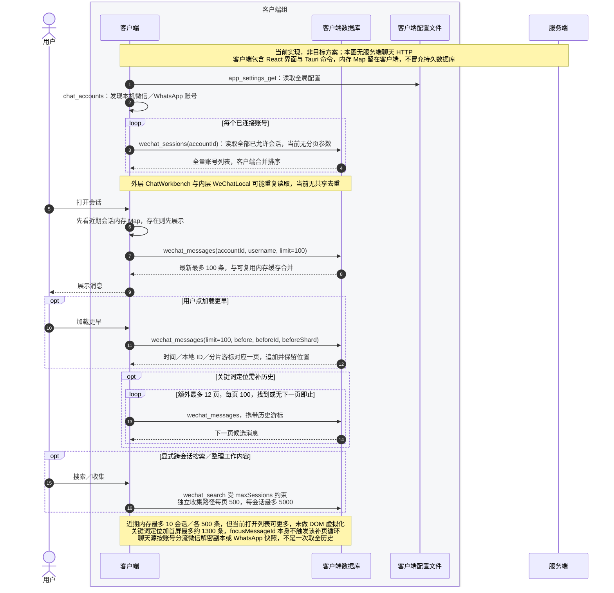
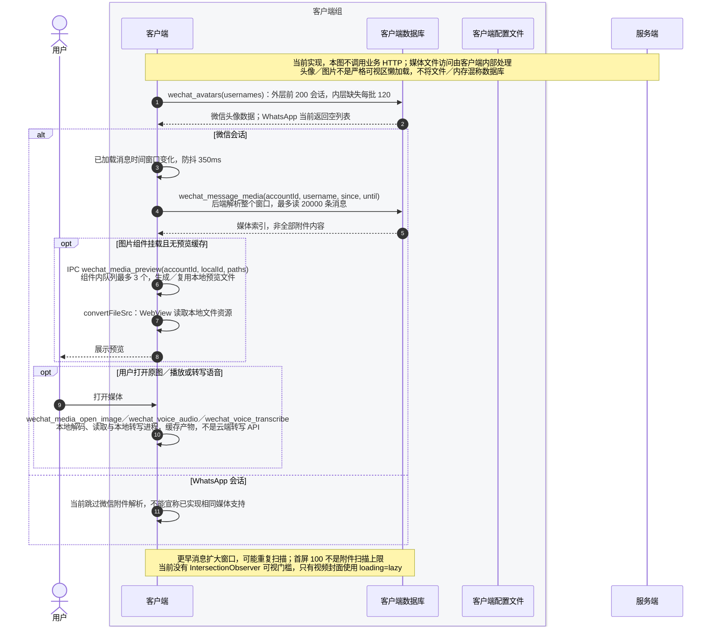
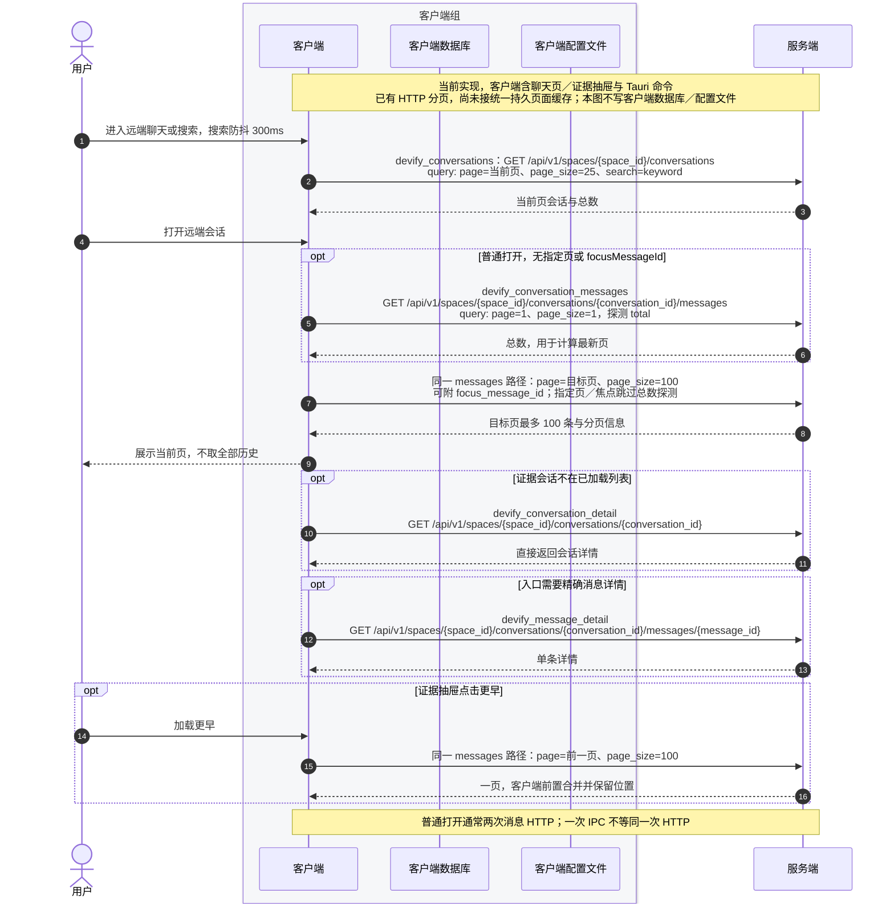
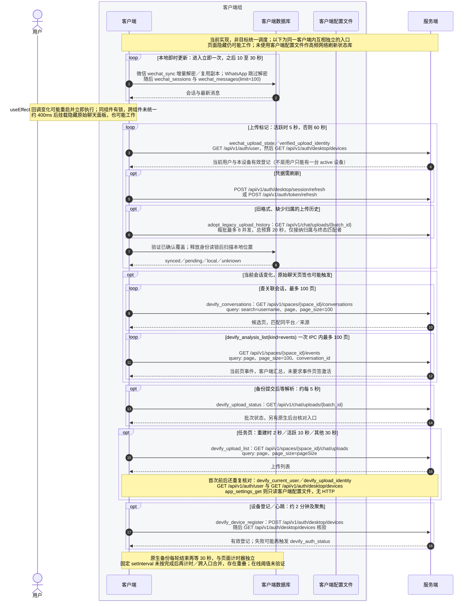

# 客户端加载与刷新改造前对照附录

状态：改造前基线，核对起点 275c9a2，2026-11-19。下文四张图保留历史代码事实，不代表本轮改造后的实现；新行为见设计正文与实施记录。

目标流程与实施验收见[设计正文](ASYNC_TASK_DESIGN.md)。本附录供审查前后变化：本地消息、媒体、远端分页和浏览时的附带请求。IPC 中 `wechat_*` 也可能按账号分流 WhatsApp。HTTP 路径相对配置的服务地址，未确认的服务端能力不作已实现声明。

所有图统一为用户、客户端组（客户端／客户端数据库／客户端配置文件）与服务端。客户端内含界面、Tauri 命令和原生后台；没有把这些职责虚构为独立进程。

核对入口：[ChatWorkbench.tsx](src/ChatWorkbench.tsx)、[WeChatLocal.tsx](src/WeChatLocal.tsx)、[CloudRecords.tsx](src/CloudRecords.tsx)、[EvidenceDrawer.tsx](src/EvidenceDrawer.tsx)、[lib.rs](src-tauri/src/lib.rs)。改造前任务菜单没有全局状态输入，任务页仍独立定时刷新；页面快照最多 30 项、任务页快照和近期消息缓存在内存中，微信解密库、WhatsApp 快照及媒体已有落盘。

<!-- flow:flow-7 -->
## A.1 本地消息按需加载

现状：会话列表未分页；消息首次 100 条，更早消息按游标继续读取。

现状说明：

- 会话列表一次返回每账号全部已允许会话；消息正文首次最多 100 条。不是一次加载全部消息历史，也不是所有列表都分页。
- 普通历史加载由按钮触发，当前不是滚动到顶自动翻页；消息游标包含时间、本地 ID、分片，不能仅用时间戳代替。
- 关键词定位可能额外连续取最多 12 页，每页 100 条，加首屏最多约 1300 条；找到命中或没有下一页即停止。`focusMessageId` 本身不触发该关键词补页循环。
- 当前消息 DOM 渲染所有已加载消息，未采用可视窗口虚拟列表；不断加载历史会增加当前会话的 DOM 和内存。
- 近期缓存最多 10 个会话、每个 500 条，用于快速切回；当前打开会话加载的消息可能更多，此限制不是整个活动消息列表的总上限。
- “整理工作内容”的显式范围收集走另一条路径：每页 500、每会话最多 5000；它不是普通浏览首屏加载。
- 外层 ChatWorkbench 与内层 WeChatLocal 都可能读取会话，当前没有统一共享的会话请求去重。

<!-- /flow -->

<!-- flow:flow-8 -->
## A.2 头像与媒体加载

现状：附件按消息窗口解析；图片预览挂载后排队，不是严格可视区懒加载。

现状说明：头像不是严格的可视区懒加载；图片预览在组件挂载时排队生成，当前没有 IntersectionObserver 可视区门槛。只有视频封面使用浏览器 `loading="lazy"`。因此“消息分页”“附件按消息窗口解析”“图片可视区懒加载”是三个不同概念。翻到更早消息会扩大附件扫描时间范围；当前不是仅扫描新增一页。微信附件解析后端窗口读取上限为 20000 条，不能把消息首屏 100 条视为该扫描上限。

<!-- /flow -->

<!-- flow:flow-9 -->
## A.3 远端聊天分页

现状：会话每页 25，消息每页 100；普通打开先探测总数再读最新页。

现状说明：搜索防抖 300ms；远端会话每页 25、消息每页 100，首次普通打开先用 `page_size=1` 获取总数，再读取最新页，通常产生两次消息 HTTP 请求。已有指定页或 `focusMessageId` 时跳过这个探测。证据抽屉同样每次 100，带焦点读取目标页，“更早”按钮请求前一页并前置合并；目标会话不在已加载列表时通过详情接口直接读取。

2026-11-19 只读补核对：服务端 f64da4424d08 已支持 page=last，test_api.py:406 有对应源码用例；当前两次请求是客户端数字 page 参数与计算逻辑造成的，不是服务端必须先探测。消息列表 preview 最多 280 字、单条详情才含完整 parts，当前云端聊天页只渲染 preview。目标改造见正文第三流程，以上现状时序保持按当前客户端代码描述。

<!-- /flow -->

<!-- flow:flow-10 -->
## A.4 浏览时的附带刷新

现状：本地更新、上传标记、事件与批次状态分别刷新，当前未统一调度。

现状风险：即时更新 useEffect 依赖消息相关回调，变化可能重启并立即触发；同组件有同步锁，但页面隐藏不等于取消此轮询。上传标记固定 setInterval 缺少完成后再计时和跨入口合并；组件挂载约 400ms 后会挂载原始聊天面板，隐藏状态仍可能发起工作。聊天关联事件的读取未按当前页签限定；`devify_analysis_list` 一次 IPC 内部可连续拉最多 100 页，每页 100，不能把 IPC 一次等同于 HTTP 一次。本轮仅记录，不修改运行实现。

其他已有周期：设备登记/心跳约 2 分钟及聚焦；任务页列表刷新为重建时 2 秒、活跃时 10 秒、其他 30 秒；原生备份主循环每轮完成后再等 30 秒；这些不是同一个调度入口。

<!-- /flow -->

