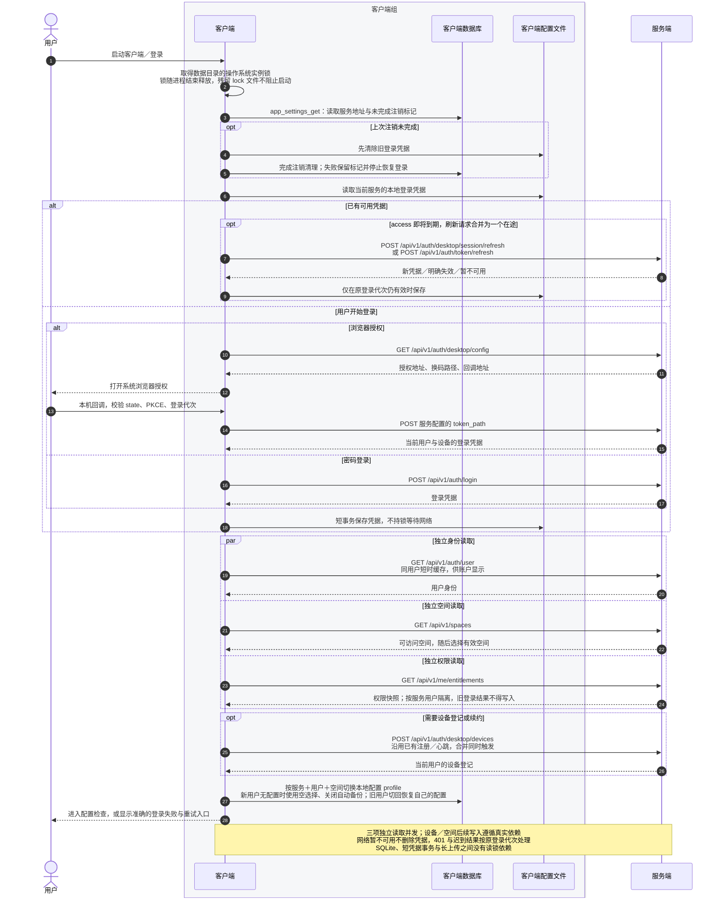
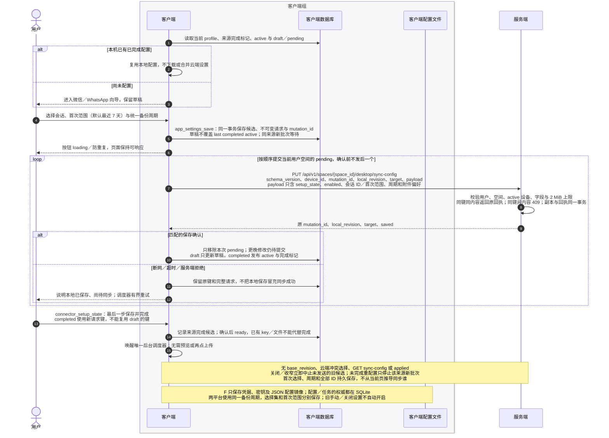
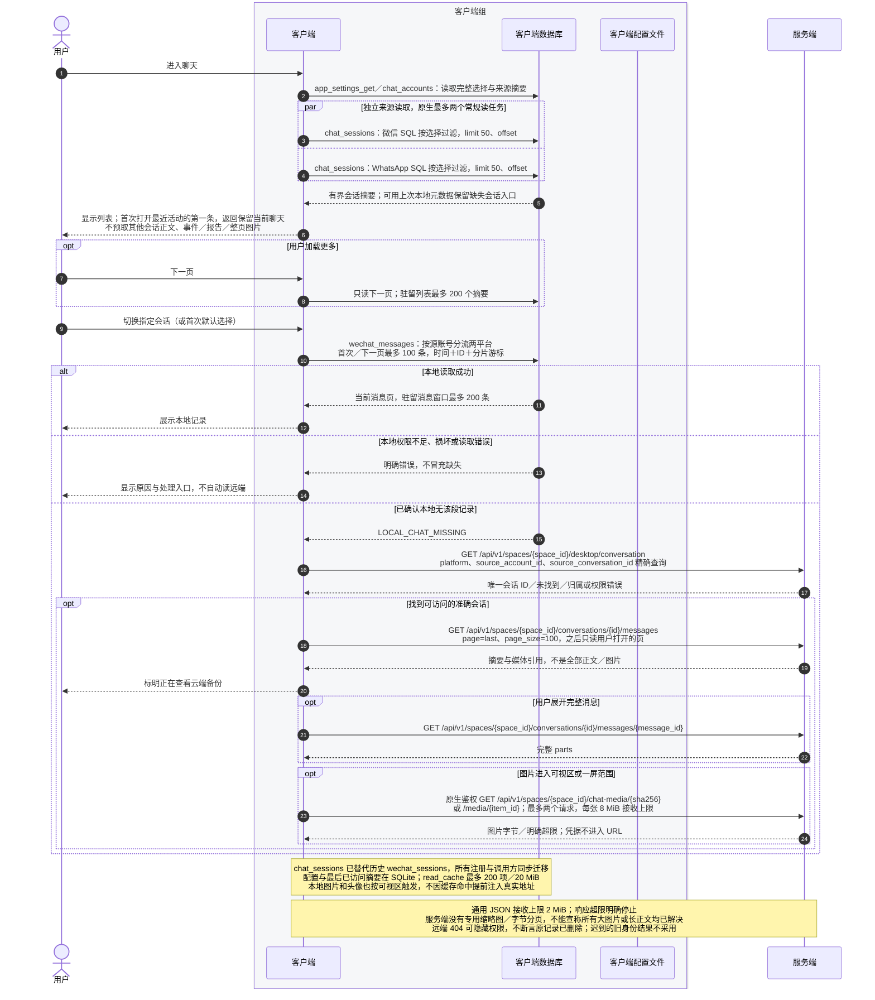
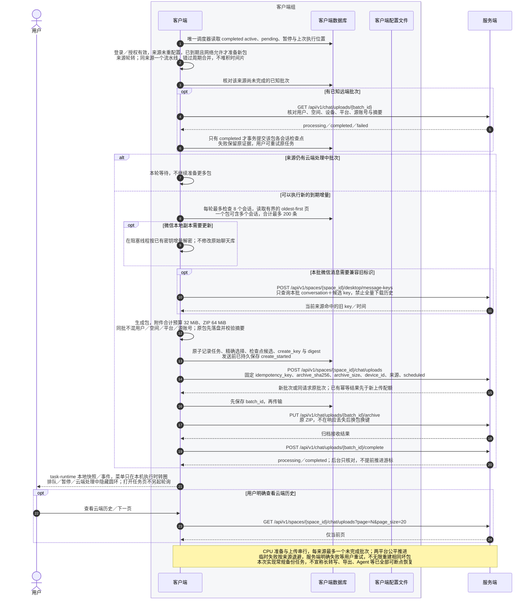
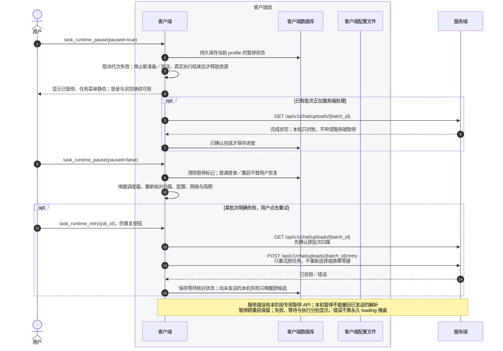
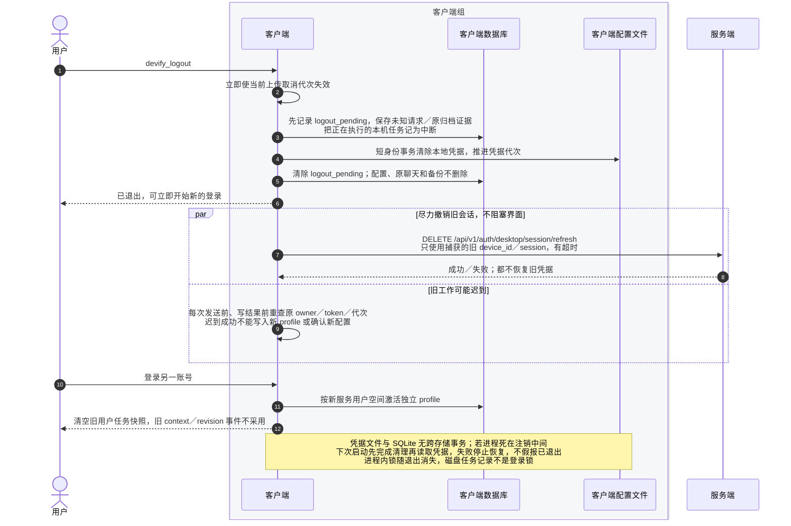
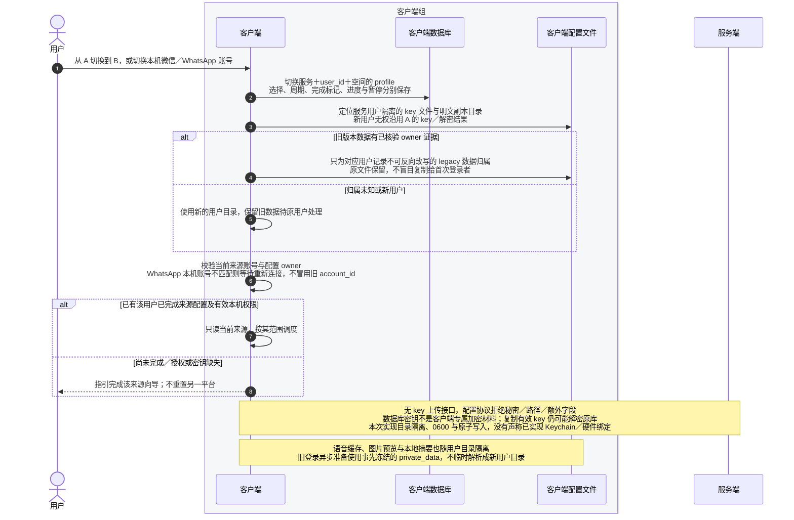
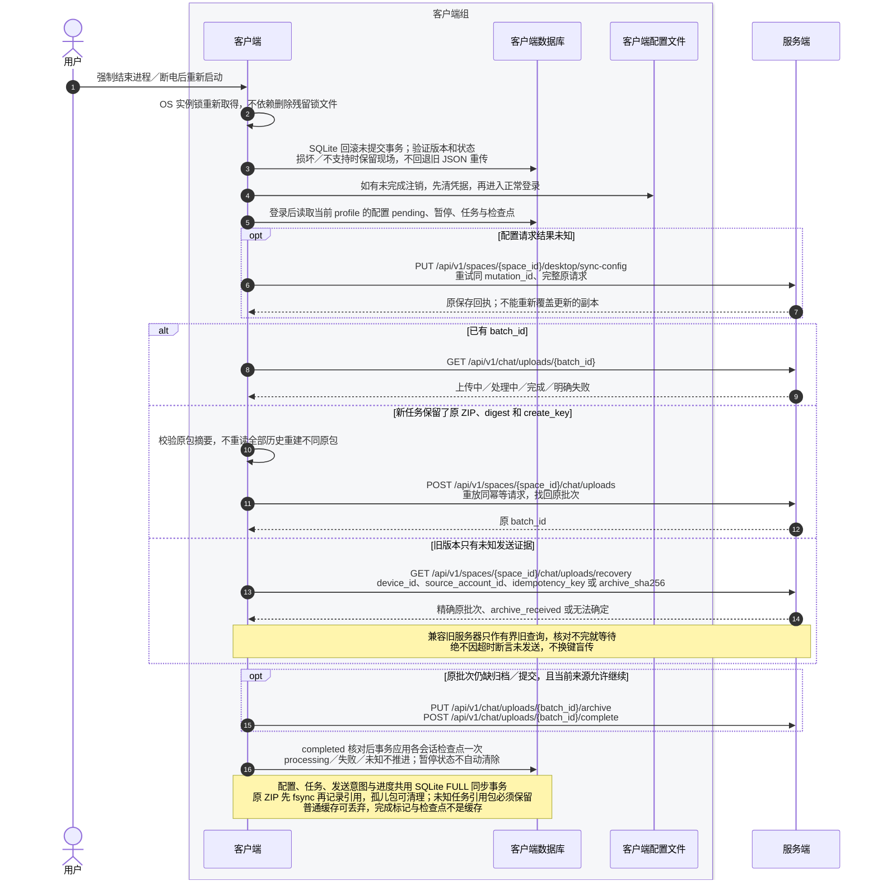
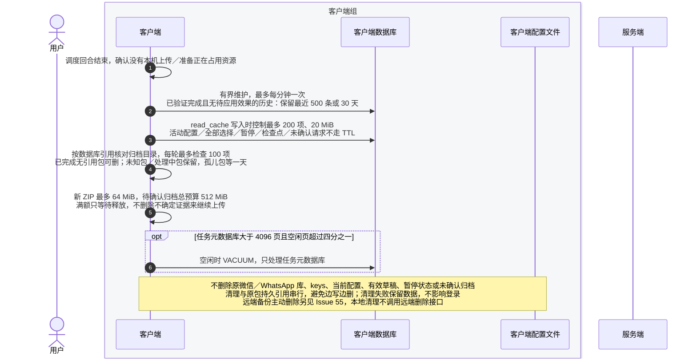

# 客户端生命周期与异步任务设计

状态：第一阶段已按本文件实现，分层自动回归与代码复核已通过；新版原生客户端连接开发环境的完整端到端验收尚未完成（2026-11-19）。第一、第二流程保留用户的绿色“已审核”标记；其余流程是本轮实现复核，不代替用户验收。实现证据与测试边界见 [实施记录](ASYNC_TASK_IMPLEMENTATION.md)。

阅读入口：[HTML 预览](ASYNC_TASK_PREVIEW.html)。以下九个流程顺序为登录 → 配置 → 浏览 → 自动任务 → 暂停 → 注销 → 来源隔离 → 异常恢复 → 清理。所有接口方法、路径和依赖都写在时序图中。改造前的四张图留在 [对照附录](ASYNC_TASK_CURRENT_STATE.md)，明确是历史基线。

## 1. 第一阶段的边界

客户端保存本机配置，服务端只保存幂等副本。用户配置时选择会话、首次时间范围及备份周期；配置完成后后台自动执行，预览不是上传前置，不新增聊天内单独上传流程。微信与 WhatsApp 共用现有统一备份周期，选择和首次范围按来源保存。旧版关闭／手动设置不会在升级时自动开启。

首期建立的是自动备份任务体系，不建设通用 DAG 或分布式调度。长转写、批量导出和 Agent 工作沿用现有功能，没有冒充已全部接入持久恢复。多设备独立上传及跨设备去重继续在 [Issue #56](https://github.com/oneprolabs/devify-desktop/issues/56) 跟踪；远端备份主动删除见 [Issue #55](https://github.com/oneprolabs/devify-desktop/issues/55)。

## 2. 统一实体、存储和简单规则

所有图只用 **用户｜客户端组〔客户端、客户端数据库、客户端配置文件〕｜服务端**。客户端是同一个 Tauri 进程的 React、IPC 和后台代码，没有虚构独立客户端 API／Worker 进程。

客户端数据库中的 `client-tasks.sqlite` 是配置、用户 profile、草稿／active、提交请求、任务、暂停和检查点的共同权威。设置与任务在同一事务内提交，`synchronous=FULL`，没有 JSON 与任务库各一份权威的问题。JSON 只用于旧版导入和可读配置镜像；发现已有 SQLite 损坏时不会回退旧 JSON。已访问元数据缓存也放在这份库的 `read_cache`，有独立数量和容量上限。

客户端配置文件只表示凭据、密钥、配置镜像等文件。原始聊天库只读；解密副本、WhatsApp 快照、图片／语音缓存和原始上传 ZIP 属于本地文件，不塞进配置请求。密钥按服务用户隔离、0600 和原子写入；本次没有宣称静态加密或操作系统凭据库已经完成。

每次保存先本地持久化，再按顺序上报。请求一旦入队就冻结 key 和 body；响应只确认自身。最后完成向导是新请求；服务端确认 completed 后才启用对应来源的新任务。已有 active 仍用于浏览，draft／pending 停止该来源新包。消息检查点只在服务端 completed 后推进，不把接收归档误当解析完成。

网络、读库和压缩不持有身份读锁。常规本地列表／消息读取最多两个；上传状态读取也受同一预算约束，聊天页隐藏后停止轮询，同一页面不重叠扫描。后台准备与上传由一个协调器串行，各来源最多一个未完成包；配置提交与只读远端核对每 30 秒独立运行，不等待本地解密／转写完成。本机执行才显示并转动任务圆环，等待云端、排队和暂停只显示普通任务图标。图片和头像进入可视区或一屏范围才激活。

<!-- flow:flow-1 -->
## 3. 启动与登录

审核：已审核（用户确认，2026-11-19）。

目标：先确认登录与本机配置归属，再允许浏览和后台任务；登录不等上传结束。

<!-- /flow -->

<!-- flow:flow-wizard -->
## 4. 本机配置、平台向导与任务交接

审核：已审核（用户确认，2026-11-19）。

目标：客户端是配置权威；每次有效保存先本地提交，再上报，完成向导与远端确认后自动交接。

<!-- /flow -->

<!-- flow:flow-cache -->
## 5. 本地会话浏览与按需备份读取

审核：实现复核，待用户验收。

目标：默认只读有数量上限的本地记录；打开具体会话且确认本地缺失，才请求远端备份。

<!-- /flow -->

<!-- flow:flow-2 -->
## 6. 自动备份与任务菜单

审核：实现复核，待用户验收。

目标：配置完成后由后台自动调度，按来源轮转，以多会话小批次上传，任务页只展示本地状态。

<!-- /flow -->

<!-- flow:flow-5 -->
## 7. 暂停、恢复与失败重试

审核：实现复核，待用户验收。

目标：暂停是可选控制，持久保留；已发送批次仍可核对，不把云端处理误称为本机正在执行。

<!-- /flow -->

<!-- flow:flow-3 -->
## 8. 注销与重新登录

审核：实现复核，待用户验收。

目标：注销只等短落盘与凭据清理，不等上传、压缩或长 HTTP；旧任务结果不能改写新登录。

<!-- /flow -->

<!-- flow:flow-key-scope -->
## 9. 登录用户、来源账号与本地密钥

审核：实现复核，待用户验收。

目标：切换 AIMyChats 用户或本机聊天账号时，分别校验来源，不继承旧用户的配置、密钥或明文副本。

<!-- /flow -->

<!-- flow:flow-4 -->
## 10. 异常退出、断电与重启恢复

审核：实现复核，待用户验收。

目标：每步以最后持久证据恢复，未知上传先核对原请求，不盲目生成新任务或提前推进进度。

<!-- /flow -->

<!-- flow:flow-6 -->
## 11. 空闲清理与容量保护

审核：实现复核，待用户验收。

目标：空闲时自动回收已确认历史与可重建缓存，始终保留未知任务、原包与用户配置。

<!-- /flow -->

## 12. 实施定位与验证边界

存储与恢复见 `task_store.rs`、`upload_archive.rs`、`instance_lock.rs`；调度见 `task_runtime.rs`；配置请求、profile 与任务 IPC 见 `config_runtime.rs`、`runtime_commands.rs`；界面使用 `taskRuntime.ts` 的共享快照和事件。通用会话入口已更名 `chat_sessions`，SQL 过滤和数量限制在两平台原生查询中完成。原始系统授权、逐库密钥校验、官方微信恢复流程继续沿用已实现逻辑。

服务端新增配置副本、精确批次恢复、本批消息标识与准确会话查询，见 [配置协议与服务端改动](CLIENT_CONFIG_SYNC_API_DESIGN.md)。控制端本轮没有新增设置编辑页，也不能反向覆盖本机配置。开发栈按既有专用解析／分析队列部署，不能只重启默认 worker 却让专用队列无人消费。

数量分页不能自动证明所有异常体积都安全：通用远端 JSON 接收有 2 MiB 上限，原生来源字段仍依赖现有解析器；专用缩略图、服务端字节分页、任意超长正文批量读取与完整 OS 凭据库仍是后续能力。不会把暂不可用、权限不足或数据库损坏说成记录已删除。测试使用独立本地源库和原生生成的合成压缩包，保留真实用户登录、密钥和聊天；不把前端 IPC 隔离测试说成重新走过真实 macOS 授权。
